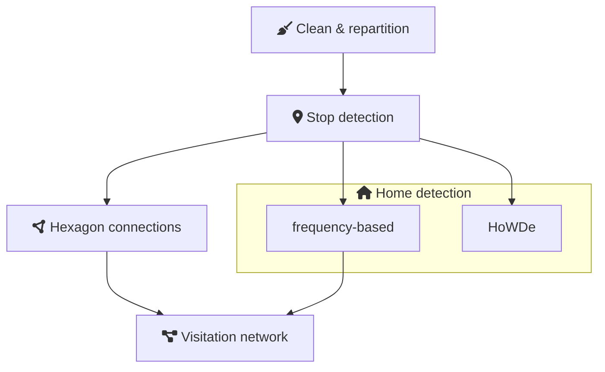

# data processing repository for DUT/COLINE/WP7

## Setup

The [`pyproject.toml`](pyproject.toml) document the required dependencies. It's suggested to use the [uv](https://docs.astral.sh/uv/) packaging tool. In this case, just issue the `uv sync` command to set up a virtual environment with all the necessary dependencies.

A script can be run through the uv, using `uv run script.py`, with the virtualenv set up by uv.

## Usage

### Repository structure

Open data, such as shapefiles extracted from OSM, are available in the `data/` folder, all the proprietary data are excluded.
The `config.yaml` in the root describes city-specific variables, such as paths for the mobility data.

Codes are in the `src/` folder, both Jupyter notebooks and scripts.

Outputs, that could be published my generated into the `output/` folder.

### Configuration

To make it easier to change between data sets all the main configuration options are read from a confid file, with the following options.

- dirs/raw_source points to the folder where the raw pickwell data is located.
- dirs/output point to the fodler where the outputs should be generated.
- city is a label, a subfolder in output will be generated for with the city name where all the actual output saved
- crs: projection with meter unit, for Hungary it is EPSG:23700. During the stop detection the standard deviation of the stop cluster longitude and latitude is calculated in meters. 
- days: The Budapest data consists of multiple intervals. The day key contains a list with objects, storing the start and the end day of the interval. The intervals are inclusive, the start and the end day is included, using the daterange function.
- id_column/id_type_column: the sample and the Budapest data have different columnn names for the device ID and the device ID type, so these are configurable.
- columns_to_drop: during the cleaning, some columns are dropped.

Notebooks of the main pipeline respects these settings. Some exploratory notebooks still only works for the Budapest data!

```yaml
dirs:
  raw_source: "/mnt/common-hdd/raw-sources/pickwell/20260205/budapest_region"
  output: "/mnt/common-hdd/group-dirs/tkom-2026-project/pickwell"

city: budapest
crs: 23700

days: 
  - start: 2023-10-01
    end: 2023-12-31
  - start: 2024-01-01
    end: 2024-02-29
  - start: 2024-10-01
    end: 2024-12-31
  - start: 2025-01-01
    end: 2025-12-31

id_column: "device_aid_hashed"
id_type_column: "device_aid_type"

columns_to_drop: 
  - "horizontal_accuracy"
  - "altitude"
  - "altitude_accuracy"
  - "ip"
  - "model"
  - "carrier"
  - "OS"
  - "OS_version"
  - "manufacturer"
  - "location_method"
```

### Pipeline

The development and analysis codes are in Jupyter notebook formats, but parts of the pipeline that runs long can be found in scripts.
Notebooks may depend on the scripts.
For example, 05_detect_stops.ipynb was used to develop the stop detection part of the pipeline, but the detect_stops.py contains the functions.
detect_stops.py can also used to process the full data.

1. 01_create_id_lookup.ipynb
2. 02_clean.ipynb
  - clean.py
3. 05_detect_stops.ipynb
  - detect_stops.py
4. 06_detect_home_and_work_locations.ipynb
  - detect_home.py

#### diagram



#### examples

run stop detection by a script on the Budapest data only for the first 8 partitions:

```
uv run detect_stops.py --input /mnt/common-hdd/group-dirs/tkom-2026-project/partitioned --output /mnt/common-ssd/group-dirs/tkom-2026-project/pickwell/stops --config 05_detect_stops_config.yaml --crs 23700 --range_end 8
```

run home detection by a script on the Budapest data only for the first 8 partitions:
```
uv run detect_home.py --input /mnt/common-ssd/group-dirs/tkom-2026-project/pickwell/stops --output /mnt/common-ssd/group-dirs/tkom-2026-project/pickwell/homes --config 06_home_detection_config.yaml --range_end 8
```

run stop detection on the whole copanhagen sample data:

```
uv run src/detect_stops.py --input /mnt/common-ssd/group-dirs/tkom-2026-project/pickwell/copenhagen_sample/partitioned/ --output /mnt/common-ssd/group-dirs/tkom-2026-project/pickwell/copenhagen_sample/stops/ --config src/05_detect_stops_config.yaml --crs 31255
```

<!-- uv run src/detect_stops.py --config config.budapest.yaml --stop-detection-config src/05_detect_stops_config_v2.yaml --pool 8

running infostop-based stop detection using 8 threads on our server, it takes about 4 hours to process the full dataset.
19:41--23:35 
-->

## Licensing

The file-level licensing information is described in the REUSE.toml accoding to the [REUSE convention](https://reuse.software/).
