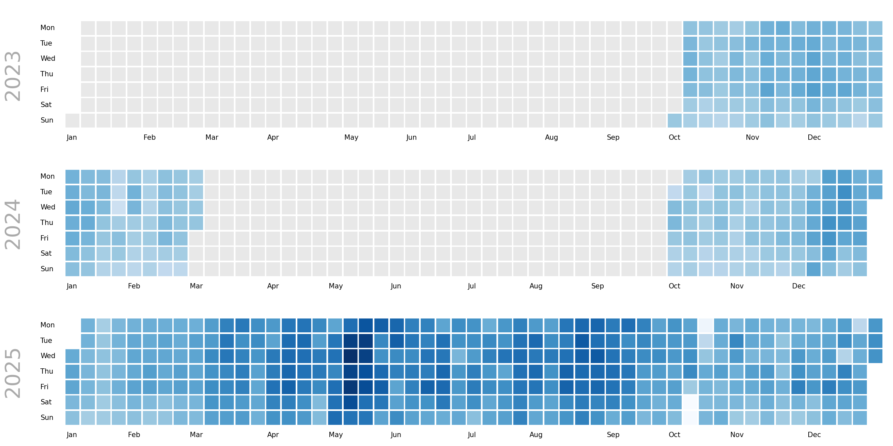
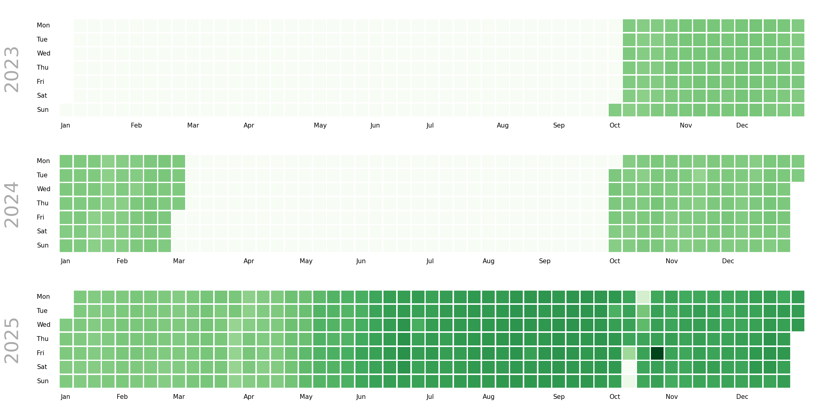

= data engineering
:author: Gergő Pintér
:email: gergo.pinter@uni-corvinus.hu
:lang: en
:sectnums: |,all|
:copyright: CC-BY 4.0
:bibtex-file: references.bib
:bibtex-style: ieee

== Introduction

The mobile posotioning data, aquired from Pickwell, contains columns outside device ID, location and timestamp.
The main goal of the preprocessing is to normalize and restructure the raw data.

We intend to use infostop for stop detection, which requires the data to be sorted by device ID _and_ timestamp.
However the raw data is stored daily.

.File structure of the raw data
----
   ├──YYYY
   │   ├── MM
   │   │   ├── DD
   │   │   │   └── location-82840-part0000.csv.gz
   │   │   ├── DD
   │   │   │   └── location-82840-part0000.csv.gz
   │   │   ├── DD
   │   │   │   └── location-82840-part0000.csv.gz
   │   │   │   └── location-82840-part0001.csv.gz <1>
----
<1> the parts contain at most 5 million records, so more than one file should be expected in a day folder

.Columns of the raw data
[cols="2*", options="header"]
|===========================================================================
| column              | details
| timestamp           | unix epoch (integer)
| device_aid_hashed   | string represented hexadecimal hash value, 32-character long
| aid_type            | refer to Android or iOS advertisement ID
| latitude            | float
| longitude           | float
| horizontal_accuracy | float
| altitude            | float
| altitude_accuracy   | float
| location_method     | gps, fused, wifi, or cell
| ip                  | IP address, string
| OS                  | Android or iOS, shows the same info as the aid_type
| OS_version          | string
| manufacturer        | string
| model               | string
| carrier             | probably network operator
|===========================================================================

== Cleaning

The main content of mobile potitioning data sets is the device ID, the location and the timestamp.

=== Drop insignificant columns

To normalize the data, the less significant columns are dropped, including horizontal_accuracy, altitude, altitude_accuracy, ip, model, carrier, OS, OS_version, manufacturer, and location_method.

OS and OS version will be processed as a device-based supplementary table.
On demand, the rest of the columns as well.

=== Set timezone

The timestamp looks like a unix epoch, which is the number of seconds that have elapsed since 00:00:00 UTC on January 1, 1970. So, the timezone is set to Europe/Budapest.

=== Replace device IDs

The hashed device IDs are 32-character long srtings.
As it is faster to compare integers than strings, I replaced the string IDs to integer ones.
This also saves storage.
Considering ASCII represented CSVs, the longest ID it 7 character (as there 1652460 unique devices in the data), which saves 25 bytes as the worst case scenario.
Given that the data contains 2860417726 records, the ID replacement could save about 66GB of storage, storing uncompressed.

=== Clean OS version

TBW

== Partitioning by device ID

For partitioning the data by device IDs, the same method was used as before, with the former mobile positioning data.
The first two characters of the hashed ID was used as a partition ID. 
For example: `17d6021bd57f46018332cba788e055d7` -> `17`.
As the hash is a hexadecimal number, two digits can represent 256 differnet values, so the data is partitioned to 256 groups.

xref:partition_stats[xrefstyle=short] shows some descriptives about the number of records and unique devices across partitions.

.Partition descriptives
[cols="2,>2,>2", options="header,unbreakable", id="partition_stats"]
|===================================================
| statistic  | number_of_records | number_of_devices
// | count      | 256               | 256              
| mean       | 11173507          | 6455             
| std        | 2886655           | 115              
| min        | 6552223           | 6153             
| 25%        | 8822529           | 6382             
| 50%        | 9466836           | 6459             
| 75%        | 14584310          | 6536             
| max        | 16702601          | 6765             
|===================================================

== Descriptives

For WP7, we have one full year (2025), and the last three months from 2023, the two first and the last three from 2024.
xref:number_of_records_dayplot[xrefstyle=short] shows the activity distribution.
Summar days seems to have more activity, though May is especially busy, seems all rigth.
There are also a few "missing" days in October 2025. There are actvitiy, on those days (11-13), it is just much less then normally would.
I suspect that there was some kinf of service outage (at one of the providers).

Next, I made the same figure, but with the number of unique devices (xref:number_of_unique_devices_dayplot[xrefstyle=short]).
During summer there are slightly more devices as expected, the end of 2025 also seems to have more devices than the previous year, which is also good, shows that the data may improving.
The outage is observable in this Figure as expected.
However, there is on particular day in October, which is an absolute outlier.
It is abound twenty-something, so I though it would be 23, when there was a "Peace March" (a kind of pro government demonstration).

The issue is that the outlier day is 24 October, which I cannot explain at this point.

.Daily record distribution

.Number of daily device distribution

== Stop detection

As of 9 April, only the first partition (`00`) is being processed, so everything from behind this section refers only to that partition.

For detecting stops, infostop is used cite:[aslak2020infostop].
As the partitioned data is also sorted coording to the infostop requirements, the stop detection runs about two and a half minutes on partition `00`.
After clustering the pings into stops, the data looks like xref:stop_labels[xrefstyle=short].

[cols="6*", options="header", id="stop_labels"]
.After stop detection
|============================================================================================
| timestamp                 | device_id | device_aid_type | latitude | longitude | stop_label
| 2024-10-02 02:37:09+02:00 | 1         | AAID            | 47.4799  | 19.0742   | 2         
| 2024-10-02 03:17:49+02:00 | 1         | AAID            | 47.48    | 19.0742   | 2         
| 2024-10-02 03:26:50+02:00 | 1         | AAID            | 47.4768  | 19.0752   | -1        
|============================================================================================

=== Configuring Infostop
We used Inforstop before while working with a similar mobile positioning data, from another data aggregator.
Based on that experience, Sándor Juhász defined parameters for Infostop (see xref:infostop_config[xrefstyle=short]).

[#infostop_config,yaml]
.Current Infostop configuration
----
infostop:
  # meters - spatial radius for stop detection
  r1: 200
  # meters - radius for merging nearby stops into places
  r2: 75
  # seconds - minimum duration to count as a stop
  min_staying_time: 240
  # seconds - max gap within a stop before it's split
  max_time_between: 7200
  # minimum number of pings required inside a stop
  min_size: 2
----

=== Additional calculations

* [ ] cluster center
* [ ] time spent at stop
** oldest timestamp - latest one
* [ ] distance between stops
** previously we had it, but do we need it?

== Home detection