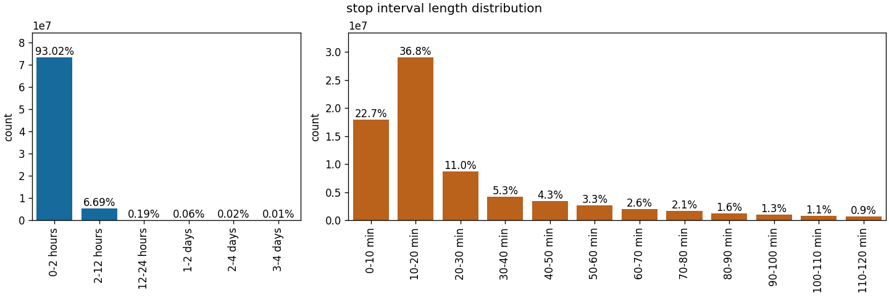
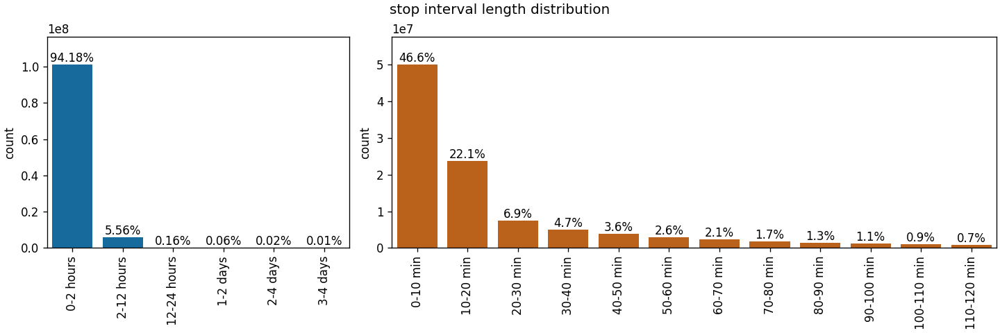
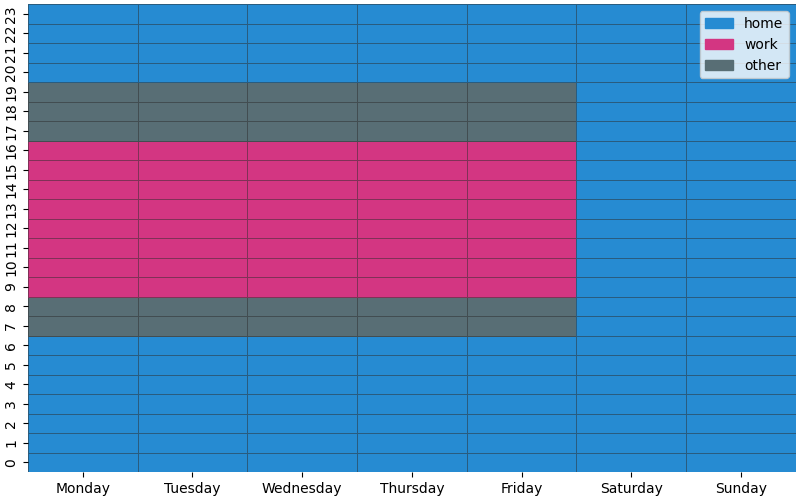
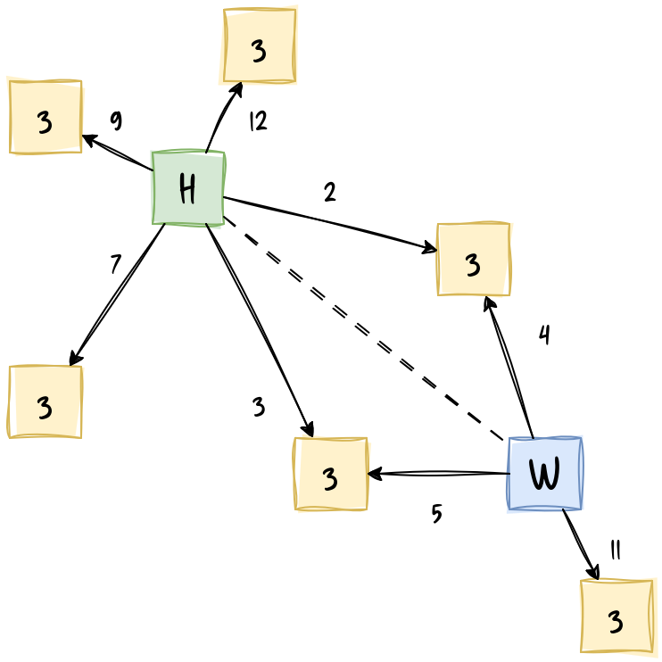
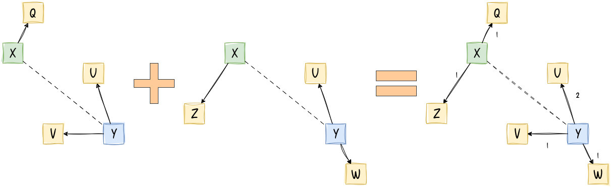
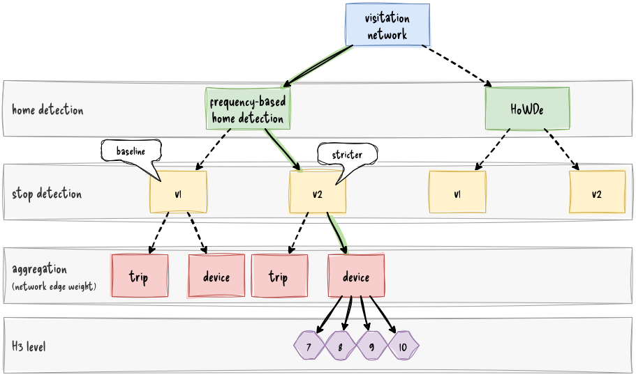
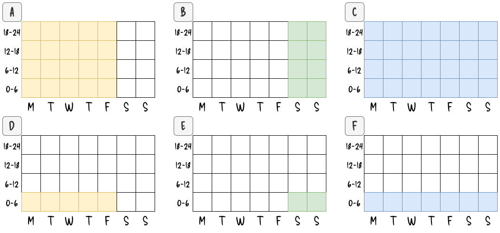
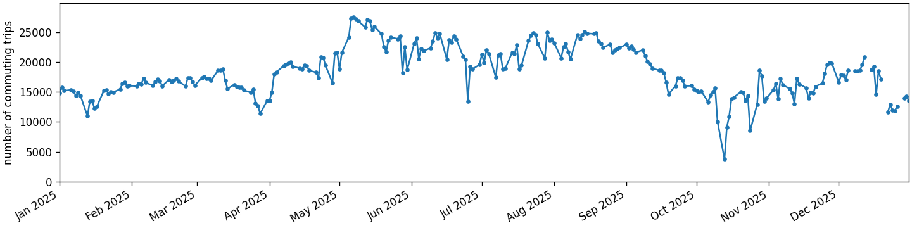

= Data Engineering
:description: Technical documentation of the WP= data engineering task
:author: Gergő Pintér
:email: gergo.pinter@uni-corvinus.hu
:lang: en
:sectnums: |,all|
:copyright: CC-BY 4.0
:bibtex-file: references.bib
:bibtex-style: ieee
:xrefstyle: short
:title-page:
:title-logo-image: image:themes/front.jpg[top=0,align=center,pdfwidth=100%]
:toc: macro
:source-highlighter: rouge
:rouge-style: magritte

<<<
// [.title]
// {doctitle}

:sectnums!:
== Project Information
:sectnums:

[cols="1,2", frame=none, grid=columns, margin-bottom=5cm]
|=============================================================================
| [.colinegreen]#Project acronym#               | COLINE
| [.colinegreen]#Full title#                    | Complex Links of Neighbourhoods
| [.colinegreen]#Work Package#                  | WP7 -- Amenity visits around home and work
// | [.colinegreen]#Deliverable number#            |
// | [.colinegreen]#Deliverable lead organisation# | Corvinus University of Budapest
// | [.colinegreen]#Reviewer organisation#         |
| [.colinegreen]#Authors#                       | {author}
// | [.colinegreen]#Status#                        |
// | [.colinegreen]#Date#                          |
|=============================================================================

// +++
//  
//  
//  
//  
//  
//  
//  
//  
//  
//  
//  
//  
//  
//  
//  
//  
//  
// +++

// image::themes/front.jpg[role=foo]

<<<

toc::[]

<<<

== Introduction

The mobile posotioning data, aquired from Pickwell, contains columns outside device ID, location and timestamp.
The main goal of the preprocessing is to normalize and restructure the raw data.

We intend to use infostop for stop detection, which requires the data to be sorted by device ID _and_ timestamp.
However the raw data is stored daily.

.File structure of the raw data
----
   ├──YYYY
   │   ├── MM
   │   │   ├── DD
   │   │   │   └── location-82840-part0000.csv.gz
   │   │   ├── DD
   │   │   │   └── location-82840-part0000.csv.gz
   │   │   ├── DD
   │   │   │   └── location-82840-part0000.csv.gz
   │   │   │   └── location-82840-part0001.csv.gz <1>
----
<1> the parts contain at most 5 million records, so more than one file should be expected in a day folder

.Columns of the raw data
[cols="2*", options="header"]
|===========================================================================
| column              | details
| timestamp           | unix epoch (integer)
| device_aid_hashed   | string represented hexadecimal hash value, 32-character long
| aid_type            | refer to Android or iOS advertisement ID
| latitude            | float
| longitude           | float
| horizontal_accuracy | float
| altitude            | float
| altitude_accuracy   | float
| location_method     | gps, fused, wifi, or cell
| ip                  | IP address, string
| OS                  | Android or iOS, shows the same info as the aid_type
| OS_version          | string
| manufacturer        | string
| model               | string
| carrier             | probably network operator
|===========================================================================

== Cleaning

The main content of mobile potitioning data sets is the device ID, the location and the timestamp.

=== Drop insignificant columns

To normalize the data, the less significant columns are dropped, including horizontal_accuracy, altitude, altitude_accuracy, ip, model, carrier, OS, OS_version, manufacturer, and location_method.

OS and OS version will be processed as a device-based supplementary table.
On demand, the rest of the columns as well.

=== Set timezone

The timestamp looks like a unix epoch, which is the number of seconds that have elapsed since 00:00:00 UTC on January 1, 1970. So, the timezone is set to Europe/Budapest.

=== Replace device IDs

The hashed device IDs are 32-character long srtings.
As it is faster to compare integers than strings, I replaced the string IDs to integer ones.
This also saves storage.
Considering ASCII represented CSVs, the longest ID it 7 character (as there 1652460 unique devices in the data), which saves 25 bytes as the worst case scenario.
Given that the data contains 2860417726 records, the ID replacement could save about 66GB of storage, storing uncompressed.

=== Clean OS version

Cleaning the OS version is for calculating the phone's age.
It is possible to associate OS release date for devices whose the OS and the OS version are known.
The release dates are collected in link:https://yaml.org/[YAML] format in `data/os_version.yaml`, collected manually from a Wikipedia pages link:https://en.wikipedia.org/wiki/Android_version_history[Android version history], and link:https://en.wikipedia.org/wiki/IOS_version_history[iOS version history].

As advertisement ID do not survive factory resets or phone changes, it is safe to assume that each device has exactly one OS version. The data comfirms this.
So, the last day of the activity and the OS version information is gathered for each device.
Then, the phone's relative age is calculated subtracting the _release date_ from the _last active day_, as in cite:[pinter2021analyzing].
The relative age is expressed in days, and xref:relative_age[] shows some sample lines.
Device 8 is using an almost 11-year old Android phone, while device 32 is using an almost 5-year old iPhone.

Note that, OS can be updated on some devices. Some manufacturers like Apple and Google offer multiple years of updates, lower-end devices usually has very limited upgradeability.
In other words, the relative age is a lower limit, the devices could be even older if the OS was updated.

.Sample records for phone's relarive age
[cols=">1,1,>1,^2,^2,>2", options="header,unbreakable", format=csv, id="relative_age"]
|===
device_id,OS,OS_version,last_active_day,release_date,relative_age
8,Android,5,2025-10-24,2014-11-04,4007
30,Android,10,2025-12-26,2019-09-03,2306
32,iOS,14,2025-07-18,2020-09-16,1766
64,Android,11,2024-12-24,2020-09-08,1568
76,Android,8,2025-10-24,2017-08-21,2986
|===

[#sec:partitioning]
== Partitioning by device ID

For partitioning the data by device IDs, the same method was used as before, with the former mobile positioning data.
The first two characters of the hashed ID was used as a partition ID.
For example: `17d6021bd57f46018332cba788e055d7` -> `17`.
As the hash is a hexadecimal number, two digits can represent 256 differnet values, so the data is partitioned to 256 groups.

xref:partition_stats[] shows some descriptives about the number of records and unique devices across partitions.

.Partition descriptives
[cols="2,>2,>2", options="header,unbreakable", id="partition_stats"]
|===================================================
| statistic  | number_of_records | number_of_devices
// | count      | 256               | 256
| mean       | 11173507          | 6455
| std        | 2886655           | 115
| min        | 6552223           | 6153
| 25%        | 8822529           | 6382
| 50%        | 9466836           | 6459
| 75%        | 14584310          | 6536
| max        | 16702601          | 6765
|===================================================

== Descriptives

For WP7, we have one full year (2025), and the last three months from 2023, the two first and the last three from 2024.
xref:number_of_records_dayplot[] shows the activity distribution.
Summar days seems to have more activity, though May is especially busy, seems all rigth.
There are also a few "missing" days in October 2025. There are actvitiy, on those days (11-13), it is just much less then normally would.
I suspect that there was some kinf of service outage (at one of the providers).

Next, I made the same figure, but with the number of unique devices (xref:number_of_unique_devices_dayplot[]).
During summer there are slightly more devices as expected, the end of 2025 also seems to have more devices than the previous year, which is also good, shows that the data may improving.
The outage is observable in this Figure as expected.
However, there is on particular day in October, which is an absolute outlier.
It is abound twenty-something, so I though it would be 23, when there was a "Peace March" (a kind of pro government demonstration).

The issue is that the outlier day is 24 October, which I cannot explain at this point.

.Daily record distribution
image::../output/descriptives/number_of_records_dayplot.png[id=number_of_records_dayplot]

.Number of daily device distribution
image::../output/descriptives/number_of_unique_devices_dayplot.png[id=number_of_unique_devices_dayplot]

== Horizontal accuracy

.Horizontal accuracy descriptives of 2023 months
[cols="2,1,1,1,1,1,1,1,1,1,1,1,2", options="header", %unbreakable]
|=========================================================================================================================
| location method | aid type | mean  | std   | min  | 25%  | 50%   | 75%   | 90%    | 95%    | 99%    | max    | count
| cell            | AAID     | 378.7 | 500.7 | 13.8 | 20.5 | 75.85 | 560.6 | 1244.7 | 1244.7 | 1250   | 1250   | 12
| fused           | AAID     | 36.9  | 152.4 | 4    | 10.1 | 14.5  | 20    | 31.1   | 49.9   | 797    | 3001   | 120791690
| fused           | IDFA     | 37.4  | 147   | 4    | 10.2 | 14.5  | 20    | 32.1   | 53.4   | 798    | 3000.9 | 19892424
| gps             | AAID     | 26.5  | 65.7  | 4    | 9.9  | 14.9  | 22.5  | 65     | 65     | 165    | 3000.8 | 166274686
| gps             | IDFA     | 30.2  | 78.5  | 4    | 9.3  | 15.4  | 31    | 65     | 66     | 165    | 3001   | 57717589
| wifi            | AAID     | 495.7 | 763.4 | 4    | 8    | 14    | 962.4 | 1745.9 | 2007.7 | 2828.3 | 3000.8 | 28651
| wifi            | IDFA     | 401.3 | 692.7 | 4    | 8    | 12    | 698.2 | 1589.8 | 1892.5 | 2699.6 | 2998.9 | 6193
|=========================================================================================================================

.Horizontal accuracy descriptives of 2024 months
[cols="2,1,1,1,1,1,1,1,1,1,1,1,2", options="header", %unbreakable]]
|======================================================================================================================
| location method | aid type | mean | std   | min | 25%  | 50%  | 75%   | 90%    | 95%    | 99%    | max    | count
| cell            | AAID     | 10   | 3.3   | 5.2 | 6.6  | 11.6 | 12.6  | 13.8   | 14.2   | 14.6   | 14.6   | 21
| cell            | IDFA     | 12   | 3.5   | 5.2 | 9.9  | 12.5 | 15    | 16     | 16.2   | 16.3   | 16.3   | 38
| fused           | AAID     | 37.5 | 156.6 | 4   | 10.2 | 14.5 | 20    | 31.2   | 49.9   | 799    | 3001   | 183387215
| fused           | IDFA     | 34.4 | 137.4 | 4   | 10   | 14.4 | 20    | 30.9   | 48.9   | 700    | 3001   | 25983776
| gps             | AAID     | 25.5 | 59.5  | 4   | 9.5  | 14.7 | 22    | 65     | 65     | 164    | 3000.9 | 278714910
| gps             | IDFA     | 30.5 | 82.4  | 4   | 9    | 15.3 | 31.8  | 65     | 66     | 165    | 3001   | 85369524
| wifi            | AAID     | 463  | 737.3 | 4   | 8    | 13   | 892.2 | 1678.1 | 1963.7 | 2776.3 | 3000.6 | 12667
| wifi            | IDFA     | 440  | 704.4 | 4   | 8    | 13   | 862.2 | 1615.7 | 1907.4 | 2678   | 2985.8 | 2405
|======================================================================================================================

== Stop detection

As of 9 April, only the first partition (`00`) is being processed, so everything from behind this section refers only to that partition.

For detecting stops, infostop is used cite:[aslak2020infostop].
As the partitioned data is also sorted coording to the infostop requirements, the stop detection runs about two and a half minutes on partition `00`.
After clustering the pings into stops, the data looks like xref:labeled_pings[].
We feed the whole observation period with the infostop algorithm, then a consecutive number is associated to the stops (`stop_id`).
Based on the `stop_id` the pings are aggregated, and the following values are calculated (xref:stops[]):

* the number of pings in a stop
* the interval start, stop, length
* the center of the pings, and
* the standard deviation of the longitude and latitude in meters (meter-based projection is required).

.After infostop, the labeled places
[cols="2,1,1,1,1,1,1", options="header", id="labeled_pings", %unbreakable]
|=======================================================================================================
| timestamp                 | device_id | device_aid_type | latitude | longitude | place_label | stop_id
| 2024-10-02 07:24:06+02:00 | 1         | AAID            | 47.6612  | 19.0764   | 17          | 1
| 2024-10-02 07:35:29+02:00 | 1         | AAID            | 47.6612  | 19.0763   | 17          | 1
| 2024-10-05 11:06:43+02:00 | 1         | AAID            | 47.4984  | 19.0404   | 14          | 2
|=======================================================================================================

.After stop detection
[cols="2,2,3,3,3,2,2,2,2,2,2", options="header", id="stops", %unbreakable]
|==============================================================================================================================================================================================
| device id | stop id | interval start            | interval stop             | interval lenght | lat mean | lon mean | lat std | lon std | ping count | place label
| 1         | 1       | 2024-10-02 07:24:06 +02:00 | 2024-10-02 07:35:29 +02:00 | 0 days 00:11:23 | 47.6612       | 19.0764        | 4            | 0             | 2               | 17
| 1         | 2       | 2024-10-05 11:06:43 +02:00 | 2024-10-05 11:22:57 +02:00 | 0 days 00:16:14 | 47.4984       | 19.0404        | 0            | 0             | 4               | 14
| 1         | 3       | 2024-10-05 17:49:22 +02:00 | 2024-10-05 17:59:54 +02:00 | 0 days 00:10:32 | 47.4767       | 19.0751        | 0            | 0             | 3               | 8
|==============================================================================================================================================================================================

[#sec:configuring_infostop]
=== Configuring Infostop

We've used Inforstop before while working with a similar mobile positioning data, from another data aggregator.
// Based on that experience, Sándor Juhász defined parameters for Infostop (see xref:infostop_config[]).
Currently, the default (v1) parameter set is like xref:infostop_config[], a stricter configuration (v2) is xref:infostop_config_v2[].

[#infostop_config,yaml]
.Infostop configuration (version 1)"
----
infostop:
  r1: 80                      # meters -- the maximum roaming distance allowed for two points within the same stay
  r2: 80                      # meters -- the typical distance between two stays in the same destination
  min_staying_time: 600       # seconds -- the minimum duration of a stay (10 min)
  max_time_between: 720       # seconds -- the maximum time difference between two consecutive records for them to be considered within the same stay (12 min)
  min_size: 2                 # minimum number of pings required inside a stop
  distance_metric: "haversine"
----

[#infostop_config_v2,yaml]
.A stricter Infostop configuration (version 2)"
----
infostop:
  r1: 30                      # meters -- the maximum roaming distance allowed for two points within the same stay
  r2: 30                      # meters -- the typical distance between two stays in the same destination
  min_staying_time: 300       # seconds -- the minimum duration of a stay (10 min)
  max_time_between: 720       # seconds -- the maximum time difference between two consecutive records for them to be considered within the same stay (12 min)
  min_size: 2                 # minimum number of pings required inside a stop
  distance_metric: "haversine"
----

=== Comparison

With the stricter (v2) configuration, the stop detection found stops for additional 62713 devices, and detects 28.5 million more stops, and 4.6 million more places.
<<stop_count_comparison>> and <<place_count_comparison>> show the high-level comparison of the detected stops and place using _v1_ and the _v2_ configuration variants.
Note that the sum of stops (and places) are just the sum of all stops (places) of all devices, these are not distinct locations.

.Comparing the stop counts of the devices between the two configuration of the Infotop. The sum of stops means the sum of all stops of all devices.
[cols="2,2,2,2", options="header",format=csv,id="stop_count_comparison"]
|===
stop count,v1,v2,diffrence
device count,1101097,1163810,62713
mean,72,92,20
std,160,209,49
min,1,1,0
25%,3,4,1
50%,15,18,3
75%,63,80,17
max,4269,7329,3060
sum of stops,79007357,107601365,28594008
|===

.Comparing the place counts of the devices between the two configuration of the Infotop. The sum of places means the sum of all places of all devices.
[cols="2,2,2,2", options="header",format=csv,id="place_count_comparison"]
|===
stop count,v1,v2,diffrence
device count,1101097,1163810,62713
mean,8,11,3
std,11,17,6
min,1,1,0
25%,2,2,0
50%,4,5,1
75%,9,13,4
max,384,707,323
sum of places,8510685,13151337,4640652
|===

=== Altitude

> I just want to share a little thought regarding the possibility of using altitude in stop detection -- we discussed about this with Riccardo Di Clemente (so shared thoughts).
> GPS calculates positioning based on the geometry of the satellites up in the sky. As such, we get a highly accurate horizontal position given your device is properly surrounded -- that's not fully true for altitude. Think of it this way: the intersection of range spheres from satellites that are all above you produces a much tighter constraint horizontally than vertically. The "cone" of uncertainty from the satellite geometry is elongated along the vertical axis.
> Because of this lopsided geometry, the Vertical Dilution of Precision (VDOP) is inherently weaker than the horizontal geometry. As a rule of physics, GPS altitude is typically 1.5 to 3 times less accurate than latitude and longitude (HDOP).
> In practical numbers, if you have an horizontal accuracy about 5-10 meters -> 15-30 m vertical accuracy (that's a building height).
> Whatever stop detection algorithms you are using, they will look for a high density of GPS points within a tight radius (a sphere, in the case with altitude) over a specific amount of time.
> Because vertical GPS data is so noisy, an object sitting perfectly still on a desk might register altitude fluctuations.
>
> -- Antonio Desiderio

=== Repartition by date

The reason behind partitioning the data by device IDs was to speed up the data processing, but very often the stops are required from a period but for all devices.
Thus, the stops are repartitioned by year-month.

== Home detection

For the home detection a simple, absolute frequency-based model (illustrated in xref:home_detection_model[]) is used, which defined home hours from 20:00 to 7:00 and the whole at weekends, and defines work hours from 9:00 to 17:00 in weekdays.
Weekday holidays and weekend workdays are taken care of.
Home is a hexagon, where an individual has the most stop in the home intervals, work hexagon is analogously where someone has to most stops during workhours.

.A simple home detection model.

[#hw_config,yaml]
.Configuration for the home and workplace detection
----
# HH:MM as string
home_hours:
  begin: "20:00"
  end: "07:00"
# HH:MM as string
work_hours:
  begin: "09:00"
  end: "17:00"
# YYYY-MM-DD as string
weekday_holidays: ["2023-03-15", "2023-04-07", "2023-04-10", "2023-05-01", "2023-05-29", "2023-10-23", "2023-11-01", "2023-11-01", "2023-12-25", "2023-12-26", "2024-01-01", "2024-03-15", "2024-03-29", "2024-04-01", "2024-05-01", "2024-05-20", "2024-08-19", "2024-08-20", "2024-10-23", "2024-11-01", "2024-12-24", "2024-12-25", "2024-12-26", "2024-12-27", "2025-01-01", "2025-04-18", "2025-04-21", "2025-05-01", "2025-05-02", "2025-06-09", "2025-08-20", "2025-10-23", "2025-10-24", "2025-12-24", "2025-12-25", "2025-12-26"]
# YYYY-MM-DD as string
weekend_workdays: ["2024-08-03", "2024-12-07", "2024-12-14", "2025-05-17", "2025-10-18", "2025-12-13"]
----

=== HoWDe

The home (and work) location detection algorithm introduced in cite:[de2026howde].

IMPORTANT: TBW

== Hexagon network

[cols="a,a", frame=none, grid=none, id="building_network"]
|===
| image::figures/pings_stops.png[title="The pings are clustered into stops.", id=pings_to_stops]
| image::figures/blocks_network_real_pos.png[title="Stops are connected if a device had consecutive stops in two blocks.", id=stop_network]
|===

The hexagon network is analoguous to the block network used in cite:[pinter2025quantifying] (see xref:pings_to_stops[] and xref:stop_network[]).
Consecutive stops of a device within a day are turned into edges between hexagons (at different H3 levels between 7 and 10).
During the construction of the hexagon network intermediate tables are saved by partition, called "connections", which contains the device_id the day, the hour, the minute and for the convienece of later processing the day of week (see xref:connections_sample[]).
The fourth and sixth rows mean that device 6514 had a consecutive stop between hexagon `891e037a14bffff` and `891e037134fffff` on 17 June 2025.
The connection table contains the movents minute-level to serve as a foundation of network building.
Using an aggregation this could aggregated to hour-level, as shown in xref:connections_sample2[], or even further to a day-level.
With the help of the _day of week_ (dow) column weekdays or weekends can also be aggregated. 

.Connections table sample
[cols="2,2,1,1,3,3,2,1", options="header", format=csv, id="connections_sample"]
|===
device_id,day,hour,minute,source,target,weight,dow
6514,2025-06-16,10,30,891e037134fffff,891e0371347ffff,1,1
6514,2025-06-16,13,25,891e0371347ffff,891e037134fffff,1,1
6514,2025-06-16,13,42,891e037134fffff,891e037a14bffff,1,1
6514,2025-06-17,8,21,891e037a14bffff,891e037134fffff,1,2
6514,2025-06-17,8,40,891e037134fffff,891e037a14bffff,1,2
6514,2025-06-17,8,52,891e037a14bffff,891e037134fffff,1,2
|===

.Connections table sample -- hour-level aggregation
[cols="2,2,1,3,3,2,1", options="header", format=csv, id="connections_sample2"]
|===
device_id,day,hour,source,target,weight,dow
6514,2025-06-16,10,891e037134fffff,891e0371347ffff,1,1
6514,2025-06-16,13,891e0371347ffff,891e037134fffff,1,1
6514,2025-06-16,13,891e037134fffff,891e037a14bffff,1,1
6514,2025-06-17,8,891e037134fffff,891e037a14bffff,1,2
6514,2025-06-17,8,891e037a14bffff,891e037134fffff,2,2
|===

The connections tables are then aggregated by the source and target hexagon to build a full network of connections.
It is possible to aggregat ethe weight in two ways: i) simply add the weights representing every trip by a given device, or ii) only consider how many unique devices had trips between two hexagons.
Both of them are constructed: edges_trip.csv and edges_device.csv.

NOTE: Note that, the date-time filtering could be added later in the process, currently present at the visitation network construction stage.

== Visitation network

NOTE: calling this "visitation network" is more like a placeholder name. Please, provide a better one!

The visitation network relies on the hexagon network.
The main difference here is that only one hop is considered from the estimated home and work locations.
Thus, this could be callad as one-hop (or one-trip) visitation network.

// For the "Budapest diffusion" project, I have build a one-hop "conncection" (xref:one_hop_connections[]), which gathers movements between hexagons, but not complete daily trajectories.

The one-hop visitation network construction builds upon the connection tables.
Let's consider xref:one_hop_connections[] as a starting point.

.Hexagons connections (1 hop). Note that source and target are H3 hexagon IDs in integer format.
[cols="2,3,2,2,2", options="header", id="one_hop_connections"]
|====================================================
| device_id | day        | source | target | weight
| Aino      | 2026-05-19 | Y      | V      | 1
| Aino      | 2026-05-20 | X      | Q      | 1
| Aino      | 2026-05-20 | Y      | U      | 1
| Aino      | 2026-05-21 | Y      | V      | 1
| Otso      | 2026-05-19 | X      | Z      | 1
| Otso      | 2026-05-19 | Y      | U      | 1
| Otso      | 2026-05-20 | Y      | W      | 1
|====================================================

For each devices the Home and the Work hexagons are also determined. So, the one-hop "visitation network" is formed as follows:

* collect every connection where the source is the Home and the target is not the Work hexagon (so a 3rd place), and build edge between the home and all the 3rd places.
* repeat the previous but now the Work should be the source and the the targets are 3rd places.

[#sec:visitaion_network_aggregation]
=== Aggregation

xref:one_hop_connections[] is still an intermediate state, the network is aggregated to hexagons.
For the aggreation the weight is calculated in two ways (see xref:compare_weights[] for a comparison sample):

1. summing trips (one device counted more), and
2. summing unique devices

.Comparing weighting methods
[cols="4*", options="header", id="compare_weights"]
|===========================================
| source | target | weight (trip) | weight (unique device)
| X      | Q      | 1             | 1
| Y      | U      | 2             | 2
| Y      | V      | 2             | 1
| Y      | W      | 1             | 1
| Y      | Z      | 1             | 1
|===========================================

=== Commuting-aware visitation network

To be able to analyze the visitations, it would be necessary to connect visitations around the home and the work locations by the commuting information.
The "commuting-aware" visitation network is basically a merged table of the device-based commuting table (home-work), and the connections (connected stops)
Finnally, it is aggregated by home, work, source and target columns, where the source is either the home or the work hexagon.

Preliminarily, the commuting table was cleaned up a bit.
Devices without detected home or work places were removed.
Also, devices were removes whose home or workplaces were detected by less than 4 stops.

Let's say user Aino lives in hexagon X, and works in hexagon Y, then her commuting info is X-Y.
Around her home, she visits hexagons Q, and around her workplace she visits U and V.
Then, her visitaions look like xref:aino[].

Let's say Otso also lives in hexagon X and works in hexagon Y, but he visits hexagon Z around his home, and hexagons U and W around his workspace.
Then, his visitaions look like xref:otso[].

After the aggregation, the table looks like xref:aggregated[]. The network also illustrated in xref:aggregated_visual[].

.Aino's visitations
[cols="5*", options="header", id="aino"]
|============================================
| device_id | home | work | source | target
| Aino      | X    | Y    | X      | Q
| Aino      | X    | Y    | Y      | U
| Aino      | X    | Y    | Y      | V
| Aino      | X    | Y    | Y      | V
|============================================

.Otso's visitations
[cols="5*", options="header", id="otso"]
|============================================
| device_id | home | work | source | target
| Otso      | X    | Y    | X      | Z
| Otso      | X    | Y    | Y      | U
| Otso      | X    | Y    | Y      | W
|============================================

.Aggregated (by unique device) commuting-aware visitations
[cols="5*", options="header", id="aggregated"]
|=========================================
| home | work | source | target | weight
| X    | Y    | X      | Q      | 1
| X    | Y    | X      | Z      | 1
| X    | Y    | Y      | U      | 2
| X    | Y    | Y      | V      | 2
| X    | Y    | Y      | W      | 1
|=========================================

.Illustration of the aggregated (by unique device) commuting-aware visitations of Aino and Otso.

[#sec:vn_variants]
=== Variants

During the project two home detection algorithm is applied and evaluated (a simple, frequency-based and the HoWDe cite:[de2026howde]), and both of them can rely on multiple stop detection configurations.
Aggregation also matters, so there are multiple variants of the visitation network that can be constructed.
These are represented in xref:visitation_network_variants[].
Version 1 or 2 (v1 or v2 in the figure) refers to the stop detection configuration (see xref:sec:configuring_infostop[]).
Visitation network is constructed for four levels (7-10) of H3, for all branch, although the figure does not denote it.

.Structure of the visitation network variants. Solid arrows show the milestone 1 preference.

=== Datetime filtering

Primarily to match the visitation networks to the telecom dataset, datetime filters were introduced, illustrated by xref:visitation_network_datetime_filters[].
The visitations can be filtered by day of week (A-B, C shows no filter), hour (D-F), and even date range.
For example, xref:visitation_network_datetime_filters[]/A shows that only weekdays are considered, xref:visitation_network_datetime_filters[]/E shows that only the first six hours of the weekends are considered.
Note that xref:visitation_network_datetime_filters[] shows six-hour blocks to match the telecom data, but the intervals can be selected by hour, so 13-16 or 20-21 hour intervals are also valid options.

.Illustration of datetime filtering by day of week (A-C) and hour (D-F).

The xref:vn_config[] shows the configuration for the night hours of weekdays (xref:visitation_network_datetime_filters[]/D).
Besides datetime, the minimum number of stops for home and work locations can be set. By default these are simetrically 3, which means only those devices are considered fot the visitation network building that had home and work location ddetction from at least 3 stops both locations.

Other elements mentioned in xref:sec:vn_variants[] can be defined like the stop detection variant and the home detection algorithm.

[#vn_config, yaml, %linenums]
.Configuration for the visitation network
----
stop_detection_variant: v2
# frequeny | howde
home_detection: frequency
filtering:
  minimum_stops_for_home: 3
  minimum_stops_for_work: 3
  # as string, inclusive
  from_date: null
  # as string, exclusive
  to_date: null
  # as integer, inclusive
  from_hour: 0
  # as integer, exclusive
  to_hour: 6
  # as a list of integers from 1 to 7, where 1 is Monday
  days_of_week: [1, 2, 3, 4, 5]
# since filtering can be set, an output subfolder can be defined
variant: "weekdays_00_06"
----

== dynamic commuting

Due to the sparseness of the data inferring the home and work locations for short periods does not give usable results.
So, instead the work and home locations are inferred for th whole data period, and then the movements between the detected home and work locations are calcluated daily.

The daily movents are calculated based on the daily appearances in the home and work hexagons.
Based on xref:hw_occurences[], let's consider a device that has a stop at the home hexagon on 1st October and two stops at the work hexagons.
As this means that the device travelled between the home and work hexagons, it commuted to work.
On 2nd October, device number 1 has no detected stop in the home hexagon, but has a stop in the work hexagons.
This case could be interpreted as the commuting also happened.

xref:hw_occurences_evaluation[] conceptualizes with Bool algebra when commuting should be counted with a more relaxed and a stricter interpretation.
Considering fact whether the device had at least one stop in the home and work hexagons.
The relaxed commuting cares only about stops in the work hexagon, considering that the device spends the night at home no matter what.
The strict interpretation required a stop in the home _and_ in the work hexagon as well on the same day.
The relaxed interpretation only considers the work hexagon, and the strict interpretation is the _logical and_ operation.

[NOTE]
====
the current implementation uses the strict interpretation
====

.Sample home and work appearances
[cols="1,2,1,1", options="header", id="hw_occurences"]
|===================================
| device | day        | home | work
| 1      | 2021-10-01 | 1    | 2
| 1      | 2021-10-02 | 0    | 1
| 1      | 2021-10-03 | 2    | 0
| 1      | 2021-10-04 | 1    | 0
|===================================

.Relaxed and stricter evaluation of daily commuting
[cols="1,1,1,1", options="header", id=hw_occurences_evaluation]
|===================================
| home | work | relaxed   | strict
| 0    | 0    | 0         | 0
| 0    | 1    | 1         | 0
| 1    | 0    | 0         | 0
| 1    | 1    | 1         | 1
|===================================

After collecting daily device commutings, the commuting edges between the home and the work hexagons can be aggregated further by date, or groups of devices.
xref:daily_2025[] shows the daily commuting counts in the whole observation area in 2025.

== Data catalogue

Parquet format is used for data engineering level (massive data processing), and CSV for analyzation level (e.g., calculated indicators that people would use in a regression).

The output directory should be configured in the main config file, notebooks rely on it.
In this document, it is referenced as `<OUTPUT>`, denoting variables by `<>` signs.

* <OUTPUT>/partitioned/<00-ff>/pings.parquet
** the dubdirectory inside partitioned is a hexadecimal value betwee 0 and 255 (00-ff, lowercase), refering the partition (see xref:sec:partitioning[])
** a pings.parquet is about 200 MB
* <OUTPUT>/id_lookup/id_lookup.json
** a dictionary to translate the raw hased device IDs to numbers
* <OUTPUT>/id_lookup/partition.json
** a dictionary to translate the numbered IDs to partitions
** NB: as JSON keys must be strings, the IDs stored as strings.
* <OUTPUT>/stops/<VARIANT>/<00-ff>.parquet
** output tables of the infostop by partion
** stop detection can be applyed using multiple configurations distinguished by a VARIANT label. The VARIANT can be an empty string (`""`), in which case the output is placed into <OUTPUT>/stops/ folder directly (e.g., `<OUTPUT>/stops/00.parquet`). If VARIANT is not empty, a subfolder will be created (e.g., `<OUTPUT>/stops/much_better_config/00.parquet`).
** the stop detection config file (`stop_detection_config.yaml`) is copied into the folder to archive the configuration which was used to apply the stop detection.
* <OUTPUT>/homes/<VARIANT>/home_work_h3_<RESOLUTION>.parquet
** the "homes" folder contains the home ddetection results by H3 resolution, between 7 and 10
** the home detection config file (`home_detection_config.yaml`) is copied into the folder to archive the configuration which was used to apply the stop detection.
** `VARIANT` is the stop detection variant
* <OUTPUT>/hexagon_network/<VARIANT>/<RESOLUTION>/partials/connections_<00-ff>.parquet
** `VARIANT` is the stop detection variant
** the connections describes a network considering the hexagons as nodes and consecutive stops (by device and day) as edges, which is comparareble to the network used in cite:[pinter2025quantifying].
** for computational reasons this is stored by partition
* <OUTPUT>/hexagon_network/<VARIANT>/<RESOLUTION>/edges_[trip|device].csv
** `VARIANT` is the stop detection variant
** as opposed to connections_<PARTITION>, which contains connections by device and day, edges remove this level, and aggreges solely to hexagons.
** there are two ways to aggregate the network: i) by trips (`edges.csv`), and ii) by device (`edges_unique_device.csv`), described in xref:sec:visitaion_network_aggregation[]
* <OUTPUT>/visitation_network/<HOME_DETECTION>/<VARIANT>/<AGGREGATION>/<RES>/.[csv|parquet]
** commuting-aware, one-hop visitation network
** `HOME_DETECTION` is either `frequency` or `howde`
** `VARIANT` is the stop detection variant
** `AGGREGATION` is either `trip` or `device`
* <OUTPUT>/monthly_partitioned_stops/<VARIANT>/<YEAR>-<MONTH>.parquet

[bibliography]
== References

bibliography::[]
